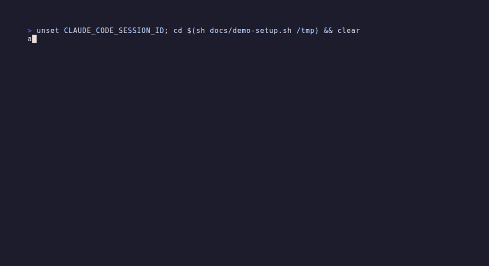

<p align="center">
  <picture>
    <source media="(prefers-color-scheme: dark)" srcset="docs/logo-dark.svg">
    
  </picture>
</p>

<p align="center">
  <a href="https://github.com/otuva/adrdom/actions/workflows/check.yml"></a>
  <a href="https://github.com/otuva/adrdom/releases/latest"></a>
  <a href="LICENSE"></a>
</p>

**A condom between production and your AI agent.**

The agent writes the questions. Only you answer. Git hooks refuse what breaks an answer.

```sh
curl --proto '=https' --tlsv1.2 -LsSf https://github.com/otuva/adrdom/releases/latest/download/adrdom-installer.sh | sh
cd your-repo && adr install --claude
adr show        # every current decision, and whose move is next
```

<p align="center"></p>

## What it solves

**The agent decides while it codes.** It picks a design mid-task, changes the spec to fit, forgets the spec, or asks a question that contains its answer. You find out at review, or never.
> A behaviour with no decision is a question first. Questions have a fixed shape, no lean. The session that asks never builds. Owner commands refuse an agent.

**Spec and code drift apart.** Decisions live in chat and prose; nothing at commit time notices. ADRs go stale.
> Every answer is a ledger row with a hash of what you read. A decision is built once a test carries `adr: <id>`. `adr check` runs at every commit, push and in CI.

**No shared vocabulary.** Each session invents words. Secrets and names leak into the repo.
> One terms file fixes meaning, frozen at answer time. Every agent reads the brief first. Banned words are stored as hashes and scanned at every commit.

**Decisions don't see each other.** The same decision is taken twice, differently. What stands on what is nowhere.
> Every question names what it depends on and supersedes. `adr plan` embeds a new question and has the agent read it against its neighbours. `adr read` reads the current set against itself.

Limit: the hooks verify a test names the decision, not that the code follows it. The guard stops an agent that runs an owner command by mistake, not one that impersonates you.

## Install

```sh
curl --proto '=https' --tlsv1.2 -LsSf https://github.com/otuva/adrdom/releases/latest/download/adrdom-installer.sh | sh
```

Windows, untested: `irm https://github.com/otuva/adrdom/releases/latest/download/adrdom-installer.ps1 | iex`. From a clone: `cargo install --path .`.

Inside the repository:

```sh
adr install            # adrdom/, hooks, AGENTS.md
adr install --claude   # + CLAUDE.md, deny rules in .claude/settings.json
adr install --codex    # + .codex/rules/adrdom.rules
adr install --planning # once per machine: embedding model + onnxruntime into the user cache
adr uninstall          # owner only; leaves adrdom/ and the cache
```

`--planning` refuses on Intel Macs (no onnxruntime build); everything else works there.

## The loop

```
agent                                      owner
  terms in adrdom/terms.md        ----->    adr approve adrdom/terms.md <name>
  headings in adrdom/decisions/<topic>.md
  adr plan <file>                 ----->    adr approve <file>
  adr ask <file>                  ----->    adr answer <id>@<version> <letter>
builder
  code + a test with `adr: <id>`
  adr check at every commit and push
```

Planner and builder are never one session. A planner's commits hold only `adrdom/`. Every command ends with the next move and who makes it: `agent`, `builder`, `owner runs: <command>` or `not yet`.

## The records

```
### Does the tool write a terms brief for the agent?
depends: 7d44030a-…, f90dbd5b-…
id: ec0b9293-…

Problem: an agent writes with term words whose definitions it has never read.
Standard: a shared vocabulary is put in front of every contributor before they write.

- A) Yes: the tool writes a terms brief from the terms file, a file made for the agent to read.
  Why: the definitions reach the agent as one short file.
  Costs: one more file, which the tool has to keep equal to the terms file.
- B) No: show prints the name, the aliases and the definition of every term.
  Why: no new file.
  Costs: the definitions reach the agent only once it runs show.

**Answer:** A
```

```
$ adr show adrdom/decisions/terms-brief.md
[approved] Terms brief (adrdom/decisions/terms-brief.md)
[answered A] Does the tool write a terms brief for the agent?
  Yes: the tool writes a terms brief from the terms file, a file made for the agent to read.
```

```
$ tail -1 adrdom/state/ledger.tsv
2026-10-15T19:24:20Z	answered	459c1b77-…	d1cac21e…	A	0.3.0
```

## Commands

| agent | |
|---|---|
| `plan <file>` | do the file's next step, print the move |
| `ask <file>` | ask the owner the file's open questions |
| `read` | read current decisions against each other |
| `show [file]` | decisions and moves |
| `check` | what the hooks run |
| `ban` | ban the lines on stdin |

| owner | |
|---|---|
| `approve <file> [entry]` | topic file, terms entry or blame file |
| `answer <id>@<version> <letter\|refuse>` | |
| `serve` | owner's page on 127.0.0.1 |
| `unban` | lift a ban |
| `uninstall` | |

## Contributing

See [CONTRIBUTING.md](CONTRIBUTING.md). Security reports: [SECURITY.md](SECURITY.md).

## License

Apache-2.0.
